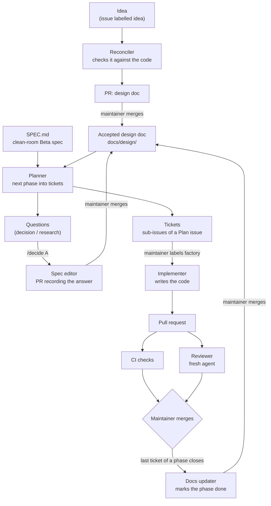

# The Mince Raft software factory

This repository is built by a pipeline of AI agents running in GitHub
Actions. One person, the maintainer, writes ideas, answers questions and
merges pull requests. Agents do everything in between: they check ideas
against the code, break them into tickets, write the code, review it, and
keep the design documents up to date.

This page explains how the pipeline works and why it is built the way it
is. Every piece described here is live in this repository; the links go to
the files that implement it.

## At a glance



The maintainer appears in only four places: writing the idea, answering
questions, choosing which tickets to build, and merging. Everything else
runs by itself.

## The agents

Each agent is a GitHub Actions workflow running
[`anthropics/claude-code-action`](https://github.com/anthropics/claude-code-action),
with its own instructions and its own narrow set of allowed tools.

| Agent | Workflow | Starts when | Does | Can't |
|---|---|---|---|---|
| Reconciler | [`claude-idea.yml`](.github/workflows/claude-idea.yml) | An issue is labelled `idea` | Checks the idea against the code, SPEC.md and other docs; opens a PR adding it as a design doc | Change anything but that one doc |
| Planner | [`claude-plan.yml`](.github/workflows/claude-plan.yml) | SPEC.md or a design doc changes on `master` | Breaks the next phase or changed sections into small tickets and questions | Write code, or add the `factory` label |
| Spec editor | [`claude-spec.yml`](.github/workflows/claude-spec.yml) | The maintainer comments `/decide <option>` on a question | Records the answer in the spec or doc it's about | Add facts about the original game; touch any other file |
| Implementer | [`claude.yml`](.github/workflows/claude.yml) | A ticket is labelled `factory` and its dependencies are closed; any issue closing (it starts tickets that just became unblocked); `@claude` in a comment | Writes the code and tests, runs every check, opens a PR | Edit SPEC.md, design docs or workflows; rebase or force-push |
| Reviewer | [`claude-review.yml`](.github/workflows/claude-review.yml) | A PR opens or changes | Reviews it against the spec, the rules in CLAUDE.md, and determinism; its verdict is a required check ([`review-gate.yml`](.github/workflows/review-gate.yml)) | Approve, merge, or override its own block |
| Docs updater | [`claude-docs.yml`](.github/workflows/claude-docs.yml) | A phase's last ticket closes; every Monday | Marks finished phases done; re-checks docs against the code | Change anything but design docs |

Plus [`ci.yml`](.github/workflows/ci.yml), which is not an agent: plain
checks that every PR must pass.

## The loop, step by step

1. **Capture.** The maintainer opens an issue, pastes a design (markdown,
   any length) and labels it `idea`.
2. **Reconcile.** The reconciler reads the idea against the actual code.
   It opens a PR adding `docs/design/<name>.md` with two new sections at
   the top: *Current state* (what already exists, with file paths) and
   *Reconciliation notes* (where the idea and the code disagree, what lives
   outside this repo, which criteria no test could check). It
   never deletes or rewrites the author's text; it only adds notes beside
   it.
3. **Accept.** The maintainer reviews and merges. Merging is acceptance.
4. **Plan.** Merging a change to a design doc starts the planner. A small
   script ([`plan_targets.py`](.github/scripts/plan_targets.py)) picks the
   doc's first unfinished phase, and the planner turns it into tickets of
   one pull request each, plus questions for anything unclear. They all
   hang off a "Plan:" issue as GitHub sub-issues, which gives a progress
   bar.
5. **Decide.** Each question lists options. The maintainer comments
   `/decide B`, and the spec editor opens a PR writing that answer into the
   document, marked "(Decided in #N)".
6. **Build.** The maintainer labels tickets `factory`, all at once if they
   like. A ticket whose dependencies are still open says what it's waiting
   on; whenever an issue closes, every approved ticket that has just become
   unblocked starts by itself. The implementer writes the code, runs the
   same checks as CI, and opens a PR that cites the spec sections it
   implements and says whether generated worlds change.
7. **Review.** CI runs the checks, including PR size. A separate reviewer
   agent, which did not write the code, reviews it and posts "Ready",
   "Ready, with nits" or "Blocked", naming the commit it reviewed.
8. **Merge.** Only the maintainer can merge, and only when the
   `review-verdict` check is green: the reviewer said Ready about the
   latest commit, or the maintainer overrode its block with a reason.
9. **Next phase.** When a phase's last ticket closes, the docs updater
   closes the plan and opens a PR marking the phase done. Merging that PR
   changes the doc, which starts the planner on the next phase.
10. **Drift.** Every Monday the docs updater re-checks every accepted doc
    against the code and opens a PR for any that no longer match.

## Design decisions

### 1. The human decides; agents do the rest

The maintainer's job is judgment: what to build, which option to take,
whether a change is good. Everything mechanical is automated. To keep that
split real:

- agents can't approve or merge pull requests;
- `master` is protected: every change goes through a PR with passing checks,
  including the required `review-verdict` and `PR size` checks;
- [`CODEOWNERS`](.github/CODEOWNERS) requires the maintainer's review for
  the files that steer the agents: SPEC.md, CLAUDE.md, design docs,
  workflows, the art brief;
- the planner never labels its own tickets for building.

### 2. A clean room the setup enforces

The terrain generator reimplements Minecraft Beta 1.7.3 terrain without
using Mojang's code. The original jar and decompiled sources live only on
the maintainer's laptop, in a gitignored `work/` folder. The maintainer
writes [`SPEC.md`](SPEC.md) (algorithms described in prose and formulas)
from that research, and agents implement from SPEC.md alone.

Running the agents in GitHub Actions makes this much stronger than a rule
on paper: the decompiled code never leaves the laptop, so the agents
cannot see it. On top of that:

- CI fails any PR containing `.jar`, `.class`, `.java` or `work/` files, or
  added lines that look like Java;
- a PR that changes SPEC.md may change nothing else, so spec changes are
  always reviewed on their own;
- every agent is told never to fill gaps from its own memory of Minecraft.
  When the spec doesn't say, it must ask;
- the spec editor may record decisions, but never facts about the original
  game. Questions that need such facts are labelled `research` and answered
  on the laptop.

### 3. Three sources of truth, kept apart

| Source | Says | Written by |
|---|---|---|
| [`SPEC.md`](SPEC.md) | How Beta terrain behaves | The maintainer, from local research |
| [`docs/design/`](docs/design/) | What we want to build on top | The maintainer's ideas, reconciled by agents |
| The code | What exists now | Agents, through reviewed PRs |

A design doc never restates Beta behaviour; it cites SPEC sections. The
gap between a doc and the code is exactly what the planner turns into
tickets.

### 4. Ask, don't guess

Wherever a spec is ambiguous, agents stop and open a question instead of
choosing. Each question lists options (A, B, ...) and is labelled
`decision` (a project choice, answerable on GitHub with `/decide`) or
`research` (needs facts about the original game). Answers are written back
into the document they're about, so the next agent reads the decision
instead of the question.

This paid off on the first real ticket: the implementer noticed the code
and SPEC 15 disagreed about decoration margins, and raised it instead of
silently picking one. The maintainer's first instinct was to change the
code to match the spec; a closer look showed that would have put visible
seams between chunks in the 3D viewer, and the spec was changed instead.

### 5. Small tickets, planned just in time

Tickets are one pull request each, at most 200 reviewable lines, and
each says what "done" means, whether world output should change, and
what's out of scope. Phases are planned one at a time, only once the
previous phase is merged, so each plan is written against code that
actually exists. Planning a whole design up front would produce tickets
that are stale before anyone builds them.

The 200-line limit is enforced, not hoped for. Review research finds
defect detection drops off past a few hundred lines, and in this repo's
first day the maintainer's time per line fell as PRs grew. The [`PR
size`](.github/workflows/pr-size.yml) check counts what a reviewer has to
read: tests, docs and generated files don't count, so the limit never
argues against tests. A ticket that can't fit becomes a first PR plus a
follow-up ticket. When a change really can't be split, the maintainer adds
the `oversize-ok` label; a label from anyone else doesn't count.

### 6. A reviewer that didn't write the code

The reviewer is a separate agent with fresh context: it sees the diff, the
ticket and the rules, not the implementer's reasoning. It checks the clean
room first, then conformance to the cited spec sections, determinism,
undeclared changes to generated worlds, the invariants in CLAUDE.md, and
whether tests test behaviour rather than just running code. It skips style
that formatters already enforce.

It has already earned its place: on the PR that added automatic phase
planning, it caught a Python cache file committed by mistake and two
real robustness gaps, all fixed before merge.

Its verdict is a gate, not advice. In the first day it said "changes
needed" on 16 PRs and every one was merged anyway, because the label
covered both real bugs (a jump cancelled by stepping up a half block, a
collision push in the wrong direction) and style nits, so it read as
noise. Now:

- **Three verdicts.** "Ready", "Ready, with nits" (never blocks) and
  "Blocked". A blocker must be a clean-room or world-output problem, a
  concrete defect with file, line, trigger and expected behaviour, or an
  unchecked claim. Everything else is a nit.
- **Evidence.** The reviewer has the CI toolchain and proves a defect
  with a test that fails on the PR, pasted into its comment.
- **A required check.** [`review_gate.py`](.github/scripts/review_gate.py)
  sets the `review-verdict` status on the PR's head commit: green for
  Ready, red for Blocked, pending until the reviewer has seen the latest
  push. A fix pushed after a block is re-reviewed before it can merge.
- **Overrides on the record.** The maintainer comments
  `/override <reason>` to merge past a block (or to skip the review of a
  trivial change). It needs a reason, it counts only if posted after the
  verdict it overrides, and only the maintainer's account counts. The
  reasons stay on the PR, so it's easy to check later which overrides
  were followed by a fix.
- **One gap.** The reviewer can't run on a PR that edits its own workflow
  file (`claude-code-action` refuses), so such PRs wait at pending until
  the maintainer reviews them and comments `/override <reason>`.

### 7. Generated worlds must not change by accident

A world is a pure function of seed and coordinates. Every PR must say
whether any block, height, biome or decoration can change for a fixed seed,
and why, with before/after statistics. New features need a test that two
overlapping regions agree block for block. When CI was introduced, the
existing code was reformatted and lint-fixed, and the rendered map for seed
12345 was compared byte for byte before and after to prove nothing
changed.

### 8. CI checks everything a reviewer shouldn't have to

[`ci.yml`](.github/workflows/ci.yml) runs on every PR:

- **Clean room:** forbidden files, Java-looking lines, SPEC.md changes
  travelling alone, design doc headers well formed;
- **Rust:** `cargo fmt`, `clippy -D warnings` (a few lints are allowed on
  purpose and listed with reasons in `Cargo.toml`), `cargo test`;
- **Wasm:** builds the WebAssembly module, fails if it grows past a
  gzipped size budget, and checks the camera flyover can still plan a route
  for three seeds;
- **Art:** validates every texture, and checks generated texture files
  still match the script that generates them.

and [`pr-size.yml`](.github/workflows/pr-size.yml) fails a PR over 200
reviewable lines (see decision 5).

Setting this up found a bug: the texture validator searched the current
folder, so run from the repo root it checked nothing and still said "ok".
CI runs it from the right folder and fails if it finds no textures.

### 9. Documents that stay true

Design docs go stale as code changes, so keeping them current is a job,
not a hope:

- the reconciler writes *Current state* from the code when a doc arrives;
- when a phase's tickets are all closed, the docs updater checks the code
  really does what the phase asked before marking it done;
- every Monday it re-checks every accepted doc and opens a PR for drift.

A CI check enforces the doc header (status, scope, phases), so the
automation can read it.

### 10. Automation that is safe to repeat

Workflows fail, get cancelled, or run twice. The planner creates its
"Plan:" issue first, with a hidden marker naming the document and phase,
and only then the tickets; the next run sees the marker and doesn't plan
the same phase again. Ticket progress lives in GitHub's sub-issues, not a
hand-maintained checklist. The mechanical parts are plain scripts, not
agents, so they behave the same every time: choosing what to plan
([`plan_targets.py`](.github/scripts/plan_targets.py)), attaching tickets
to their plan ([`attach_subissues.py`](.github/scripts/attach_subissues.py)),
and deciding which tickets are unblocked
([`tickets.py`](.github/scripts/tickets.py)).

That last split came from a real bug: the planner was asked to attach
sub-issues itself, but its tool permission, `Bash(gh api repos/.../issues:*)`,
only matches when a space follows `issues` (`:*` means " *"), so every
`gh api repos/.../issues/20` call was refused, the step was silently
skipped, and no phase could ever finish. A script after the agent now does
it every time, and path-style permissions are written as `claude/*`.

### 11. Safe on a public repository

The repository is public, so anyone can open issues and comment. Every
agent workflow:

- only starts for the maintainer's account (and, where needed, the
  Claude app's own pushes);
- only builds issues the maintainer wrote, or the planner wrote;
- passes Claude only comments from the maintainer and the Claude app, so
  a stranger's comment can't steer it;
- never runs on pull requests from forks.

The Claude GitHub app also can't edit workflow files, so no agent can
weaken its own checks.

### 12. Rules live in the repo

Everything an agent follows is versioned, reviewed text:
[`CLAUDE.md`](CLAUDE.md) (rules for every agent),
[`.github/prompts/reconcile.md`](.github/prompts/reconcile.md) (how to
reconcile a design), [`docs/design/README.md`](docs/design/README.md) (the
design doc format and lifecycle), and the prompts inside each workflow.
Changing how the factory behaves is a pull request like any other, reviewed
by the maintainer.

### 13. Cost

Agents run on a Claude subscription token rather than per-token API
billing. Each agent has a turn limit, workflows for the same issue queue
instead of running in parallel, and Actions minutes are free on public
repositories.

## Using it

| To | Do |
|---|---|
| Add an idea | Open an issue with the design as its body, label it `idea` |
| Plan a doc's next phase by hand | `gh workflow run claude-plan.yml -f file=docs/design/<name>.md` |
| Plan a SPEC.md section | `gh workflow run claude-plan.yml -f section="15"` |
| Answer a question | Comment `/decide B` on it, with reasoning on the next lines |
| Build tickets | Label them `factory`; each starts once its dependencies are closed |
| Ask for a fix on a PR | Comment `@claude <what to change>` |
| Merge past a reviewer block | Comment `/override <reason>` on the PR |
| Skip the agent review of a trivial PR | Comment `/override <reason>` before it reviews |
| Allow a PR over 200 lines | Add the `oversize-ok` label |
| Measure a branch like CI does | `python3 .github/scripts/pr_size.py origin/master HEAD` |
| Bring a stuck PR up to date | Click "Update branch", or comment `@claude merge master into this branch and resolve the conflicts` |
| See what's waiting | `gh issue list -l planned` |

## Map of the files

```
CLAUDE.md                       rules every agent follows
.github/actions/toolchain/      the Rust, wasm and Node setup agents share with CI
FACTORY.md                      this page
SPEC.md                         clean-room spec of Beta terrain
docs/design/                    design docs (README.md: format and lifecycle)
.github/CODEOWNERS              files that need the maintainer's review
.github/prompts/reconcile.md    how to reconcile a design doc
.github/scripts/plan_targets.py which phase or section to plan next
.github/scripts/attach_subissues.py  attaches tickets to their plan
.github/scripts/tickets.py      which approved tickets are unblocked
.github/scripts/review_gate.py  the reviewer's verdict as the review-verdict status
.github/scripts/pr_size.py      reviewable lines in a change
.github/workflows/
  ci.yml                        checks on every PR
  claude-idea.yml               reconciler
  claude-plan.yml               planner
  claude-spec.yml               spec editor (/decide)
  claude.yml                    implementer
  claude-review.yml             reviewer
  review-gate.yml               review-verdict status (verdicts, /override)
  pr-size.yml                   PR size check
  claude-docs.yml               docs updater
```

## Not built yet

- **Golden hashes:** recorded hashes of generated worlds, so CI rather than
  the PR description catches any change to world output.
- **Preview deploys:** a live viewer link on every PR.
- **Plan-level approval:** labelling a whole plan to build its tickets in
  order, instead of labelling each ticket.
