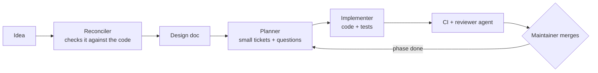

# minceraft

**Mince Raft**, a small voxel game about living on a raft, and its world
generator: a Beta-1.7.3-style overworld terrain generator written in Rust,
compiled to WebAssembly, with a small browser viewer that renders it using
the game's own 8×8 tileset. The game itself is being built here, phase by
phase, from the design docs in [`docs/design/`](docs/design/).

The generator is a clean-room implementation written from [`SPEC.md`](SPEC.md),
a prose description of the algorithm. No Mojang code or assets are in this
repository (see [Clean-room rules](#clean-room-rules)).

## How this repo is built

This project is built by a **software factory**: AI agents in GitHub
Actions that turn ideas into reviewed pull requests, with one person
deciding and merging. **[Read how it works and why →](FACTORY.md)**



- **The human decides, agents do the rest.** The maintainer writes ideas,
  answers questions (`/decide B`), picks tickets and merges. Agents can't
  approve or merge.
- **Clean room by construction.** The decompiled game never leaves the
  maintainer's laptop, so the agents, running on GitHub, can't see it. They
  implement only from [`SPEC.md`](SPEC.md), and CI blocks anything that
  looks like copied code.
- **Ask, don't guess.** When a spec is unclear, agents open a question with
  options instead of picking one.
- **A second agent reviews every PR** with fresh context, and CI checks
  formatting, lints, tests, wasm size, the flyover and the art.
- **Docs stay true.** Design docs record what exists, phases are marked
  done when the code proves it, and a weekly job flags drift.

## Quick start

```sh
./build.sh --serve        # build the wasm, then serve the viewer
# open http://localhost:8000
```

Requirements: Rust with the `wasm32-unknown-unknown` target, `wasm-pack`,
and `wasm-opt` (binaryen). On macOS:

```sh
rustup target add wasm32-unknown-unknown
arch -arm64 brew install wasm-pack binaryen
```

`build.sh` options:

| Command | Does |
|---|---|
| `./build.sh` | export textures, build the wasm, run `wasm-opt -Oz`, print its size |
| `./build.sh --test` | run `cargo test` first |
| `./build.sh --serve` | serve `viewer/` on port 8000 afterwards |
| `./build.sh --serve-client` | serve the repo root on port 8000; the debug camera is at `/client/` (click to lock the pointer; `?log=60` logs frame times to the console, `window.frameStats()` returns them) |

## Repository layout

```
SPEC.md               algorithm spec the generator is implemented from
build.sh              build script (see above)
art/
  PROMPT.md           prompt and palette for the pixel-art textures
  batches_*.json      the tileset, one file per group of batches
  tools/              sheet builder, validator, export_textures.py
data/
  blocks.toml         every block: id, name, fire values, collision, opacity, colour
  biomes.toml         biome table, lookup thresholds, plant counts, tree shapes,
                      spawn lists, our own grass/leaf/sky colour ramps
crates/
  terrain/            the generator: no_std + alloc, zero runtime dependencies
    build.rs          turns data/*.toml into Rust constants at compile time
    src/climate.rs    the one climate source + biome lookup
    src/decorate.rs   decoration cells, passes, protected mask, snow
    src/trees.rs      oak, birch, two taiga trees, big oak
    src/plants.rs     flower / grass / dead bush / cane / cactus / pumpkin patches
    examples/stats.rs native timing, biome and vegetation statistics, PPM map
  web/                wasm-bindgen wrapper used by the viewer
viewer/
  index.html          the viewer page (no frameworks)
  mesh.js             block meshing, shared by the 3D view and the workers
  worker.js, pool.js  background workers (map tiles, flyover plans and chunks) and their queue
  flyover/            flyover video: planner and player (see its README)
  pkg/                build output (gitignored)
  textures.json       full tileset exported by build.sh (gitignored)
client/
  index.html, scene.js  debug camera page: viewer terrain, fly camera, frame-time overlay
  fly.js, frametimes.js 20 Hz fly sim with interpolation; rolling p50/p99 frame times
  input.js, tiles.js    pointer-lock input feed; tile array for the viewer's mesher
```

## The terrain crate

```rust
use terrain::{generate_region, generate_decorated, Block};

let terrain = generate_region(seed, x0, z0, width, depth);    // terrain only
let world = generate_decorated(seed, x0, z0, width, depth);   // + trees, plants, snow
// region.blocks: Vec<u8>, region.height == 128
// index = ((z * width) + x) * 128 + y
```

- **Determinism:** a block's value depends only on the seed and its world
  coordinate, never on the region origin or size. Adjacent or overlapping
  regions always agree, with or without decoration.
- **Heightmaps:** `generate_heightmap` (terrain) and
  `generate_heightmap_with_biases(.., decorate)` return the top block and
  height per column. `generate_coarse_heightmap(seed, x0, z0, step, nx, nz)`
  surveys a wide area cheaply: terrain height, biome and overhang gaps at
  every `step`-th column, read straight off the density lattice (about 14×
  faster per area; used by the flyover to find islands).
- **Climate and biomes:** `climate_at(seed, x, z) -> (T, H)`,
  `biome_at(seed, x, z) -> Biome`, and `generate_climate(..)` for a whole
  region (T, H and biome id per column). `Climate` is the single climate
  source; the density field, surface pass, sea ice, decoration and snow all
  read it.
- **Hooks:** `generate_region_with_biases(seed, x0, z0, w, d, &Biases, decorate)`
  takes a `Biases` bundle:
  - `density`: `DensityBias` terms (any `Fn(i32, i32, i32) -> f64`), added
    to the terrain density just before the solid/air test (world
    coordinates). Positive adds land, negative carves it. For island bumps,
    spawn water and route channels.
  - `temperature`: `TemperatureBias` terms (any `Fn(i32, i32) -> f64`),
    added to T and clamped to [0, 1] before T is used anywhere.
  - `protected`: an optional `ProtectedMask` (any `Fn(i32, i32, i32) -> bool`,
    or the `ColumnMask` bitmask over `(x, z)` columns). Decoration never
    modifies a protected cell; a tree that would touch one is skipped whole.
  `generate_region_with_bias` (density only) still works as before.
- **Decoration in place:** `decorate(&mut region, &generator, &biases)` runs
  the vegetation pass over an existing region. It can't see beyond the
  region's edges, so prefer the `generate_*` functions, which add a margin
  and crop.
- **Statistics:** `generate_decorated_with_stats` also returns per-biome
  columns, tree attempts, trees grown, plants and snow.

What it generates: 3D-noise terrain with overhangs and floating chunks, sea
level at y = 64 with ice where it's cold, grass and dirt over stone, sand and
gravel beaches, sandy deserts, eleven biomes, five kinds of tree, small
plants and snow. Caves, ores, lakes, dungeons, clay and springs are out of
scope.

### Blocks

| Id | Block | Id | Block | Id | Block |
|---|---|---|---|---|---|
| 0 | air | 9 | birch log | 18 | rose |
| 1 | stone | 10 | spruce log | 19 | sugar cane |
| 2 | dirt | 11 | oak leaves | 20 | cactus |
| 3 | grass | 12 | birch leaves | 21 | brown mushroom |
| 4 | sand | 13 | spruce leaves | 22 | red mushroom |
| 5 | gravel | 14 | tall grass | 23 | pumpkin |
| 6 | water | 15 | fern | 24 | snow layer |
| 7 | ice | 16 | dead bush | | |
| 8 | oak log | 17 | dandelion | | |

Bedrock and sandstone are still written as stone and sand.

### Data files

`data/blocks.toml` and `data/biomes.toml` are read at compile time by
`crates/terrain/build.rs`, which uses the `toml` crate as a build-dependency
only and generates the `Block` and `Biome` enums, `BLOCK_INFO`, `BIOME_INFO`,
the lookup thresholds, the tree shapes and `LEGEND_JSON`. The runtime crate
and the wasm have no dependencies and parse no TOML. Edit a file and rebuild.

- `blocks.toml`: one `[[block]]` per id with name, fire encouragement and
  flammability (SPEC 16), collision (`none` / `full` / `inset`), light
  opacity (leaves 1, water and ice 3), the opaque-cube flag and a flat
  fallback colour.
- `biomes.toml`: `[lookup]` thresholds for the SPEC 8.2 rules; shared
  `[spawns]`; `[trees.*]` shapes (height ranges, canopy radii, big-oak
  constants); and one `[[biome]]` per id with top/filler blocks, tree
  count term and kind weights, plant patch counts, spawn extras, a map
  colour and three-stop grass, leaf and sky ramps. The ramps are this
  project's own colours. Grass and leaf ramps are indexed by humidity, sky
  by temperature.

### Decoration

Features are anchored in world-aligned 16×16 cells, each with an RNG hashed
from the seed and cell coordinates. Beta's +8 chunk offset isn't used.
Cells run in four parity passes. Same-pass cells never touch, so a block
depends on at most a 4-cell chain. Generation therefore decorates the region
plus 4 cells and 8 blocks of margin, then crops, and the output is exactly
position-deterministic. Biomes are chosen per feature at its own column
(spec deviation B3), with per-cell counts that match the spec inside a
single biome. A final per-column pass removes plants that a later tree left
without support, then snow is laid down.

### Tests and native tools

```sh
cargo test                     # noise, determinism, overlap, sea fill, biome table,
                               # vegetation rules, snow/ice, protected mask, tree density
cargo run -p terrain --profile bench-native --example stats -- <seed> <x0> <z0> [out.ppm]
```

## The viewer

`viewer/index.html` loads the wasm module and shows:

- **Map:** a top-down view of 1024×1024 blocks of the decorated world
  (`heightmap_decorated`), drawn at 2 blocks per pixel, with four modes:
  - *terrain*: coloured by top block using the legend colours from
    `data/blocks.toml`, so trees (oak, birch and spruce leaves and logs),
    plants, cactus, pumpkins, snow and ice each show in their own colour.
    Land is shaded by slope and height; water is tinted by depth and ice is
    drawn over the same tint.
  - *biome*: a flat colour per biome (`map_color`), with a legend.
  - *temperature* and *humidity*: sequential colour scales (dark violet to
    pale yellow for cold to hot; pale yellow to deep blue for dry to wet),
    with a 0–1 scale bar.
  In the biome and climate modes the sea is darkened slightly so coastlines
  stay readable. Hover to see a column's block, height (and floor under
  water or ice), biome, T and H.

  How it loads:
  - A rough draft from `coarse_heightmap` shows almost at once.
  - The detail comes in 512×512 tiles, generated in parallel by background
    workers (`viewer/worker.js`, queued by `viewer/pool.js`). The tile under
    the 3D area comes first.
  - Tiles sit on a fixed world grid and the last 16 are cached, so moving the
    map reuses the tiles it already has.
- **3D view**, with two modes:
  - *chunk preview*: a WebGL2 render of a 64×64 area of
    `generate_region_decorated`. Click the map to move it, drag to orbit and
    scroll to zoom. Schools of fish swim in the sea (see [Fish](#fish)).
  - *flyover*: a 60–110 s flight from an island on the map over the most
    interesting terrain around it (peaks, cliffs, overhangs, channels, lakes,
    big biomes). It plays at 1280×720 with captions and can be recorded to an
    MP4 or WebM file. The route and camera are drawn on the map. The flyover
    for the current map is prepared in the background, so it usually starts
    at once. See [`viewer/flyover/README.md`](viewer/flyover/README.md).
- **Stats** (the `stats` button, or `debug=1`): map generation time, tiles
  generated and cached, the `.wasm` size raw and gzipped, 3D preview timings,
  and flyover planning and chunk counts. Kept out of the main view.

URL parameters: `?seed=9&x0=100000&z0=100000&sx=150&sz=190&dist=70&yaw=0.8&pitch=0.15`
(`sx`/`sz` place the 3D area within the map; `dist`, `yaw` and `pitch` set
the camera). Add `mode=biome`, `temperature` or `humidity` to open the map in
that mode. Text seeds are hashed to a number. Add `fly=1` to open the 3D
view in flyover mode, and `debug=1` to open the stats panel.

### Textures in the 3D view

The viewer loads the full Mince Raft tileset. `build.sh` runs
`art/tools/export_textures.py`, which:

- merges every `art/batches_*.json` file in order;
- adds the palette from the table in `art/PROMPT.md`;
- checks each grid and fails on unknown palette indices or duplicate names;
- writes everything, including the creature and person models, to
  `viewer/textures.json`.

The 3D view uses these tiles from it:

| Block / object | Top | Sides | Bottom |
|---|---|---|---|
| Grass | `grass_top` (tinted) | `grass_side` (green part tinted) | `dirt` |
| Dirt, stone, sand, gravel | own tile | own tile | own tile |
| Water | `water_0`–`3`, animated | `water_flow_0`–`3`, animated | `water_0`–`3` |
| Oak log | `log_top` | `log_side` | `log_top` |
| Birch, spruce log | `birch_log_top`, `spruce_log_top` | `birch_log_side`, `spruce_log_side` | same as top |
| Oak, birch, spruce leaves | `leaves` (cut-out, tinted) | same | same |
| Cactus (inset 1/16 on the sides) | `cactus_top` | `cactus_side` | `cactus_top` |
| Pumpkin | `pumpkin_top` | `pumpkin_side` | `pumpkin_top` |
| Ice (translucent, drawn after the water) | `ice` | `ice` | `ice` |
| Snow layer (a slab 1/8 block high) | `snow` | `snow` | `snow` |
| Sun | `sun_sky`, a sprite low in the north-west sky | | |
| Fish | salmon, tuna and mackerel models from Batch 11 | | |

**Plants** (tall grass, fern, dead bush, dandelion, rose, sugar cane, brown
and red mushroom) are two crossed quads, drawn from both sides, each using
the tile of the same name from Batch 14. Tall grass and fern are tinted
like grass.

The tiles in `TILES` are required: if any is missing from `textures.json`,
the whole view falls back to flat colours. The biome tiles (Batches 13–14,
listed in `BIOME_TILES`) are optional. When one is missing, that block gets
a stand-in built in the viewer: its legend colour from `data/blocks.toml`
(with ribs for cactus and pumpkin, and a small cut-out silhouette in
`SPRITES` for plants). Birch and spruce logs fall back to `log_side`'s
shading over their legend colour, and to `log_top`.

Face culling: only full opaque cubes (stone, dirt, grass, sand, gravel, logs,
pumpkin) hide their neighbours' faces. Leaves are cut-out, so the faces next
to them, including leaf-to-leaf faces, are still drawn. The exception is
distant flyover chunks, which use fast leaves: solid, hole-free and hiding
each other (see the flyover README). Water shows faces
only next to air, plants or leaves; ice only next to non-ice, non-opaque
blocks.

**Climate tinting:** grass tops, the green part of grass sides, leaves, tall
grass and ferns take a per-column colour from that column's biome ramps in
`legend()` (grass and leaf ramps, interpolated between their three stops by
the column's humidity). Oak leaves use the leaf ramp as-is; birch and spruce
leaves blend it with their own legend colour so the three kinds stay
distinct. The sky and fog colour come from the sky ramp of the biome at the
centre of the 3D area, by its temperature.

How it works:

- At startup the viewer turns those tiles from palette strings into RGBA and
  uploads them as one `TEXTURE_2D_ARRAY` with 16×16 layers. 8×8 tiles are
  scaled up 2×; the 16×16 sky tiles fit as they are. `.` pixels are
  transparent, and the shader discards them.
- Tinted tiles store their green pixels as greyscale with alpha ~0.78. The
  shader multiplies those texels by the vertex's tint colour and leaves
  fully opaque texels alone.
- Model faces get one layer each at their native size, in the layer's
  top-left corner. The rest of the layer repeats the face's edge pixels so
  mipmaps don't bleed transparency into small faces.
- Each vertex carries a UV, a layer index, a shade and a tint. The water and
  flowing-water animations are runs of four layers. Every 300 ms the shader
  adds the current frame (0–3) to their layer.
- The geometry is four meshes:
  - opaque, drawn with a shader variant that never discards, so the GPU can
    skip hidden pixels early;
  - cut-out (leaves, plants);
  - water (alpha 0.45) and ice (alpha 0.72), drawn without depth writes
    after the fish.

  All of them share one quad index buffer.
- The sun is a camera-facing sprite, drawn first with no fog or depth so the
  terrain covers it. The orbit camera looks down, so orbit low (or use a small
  `pitch`) to see it.
- Filtering is nearest-neighbour up close, with mipmaps so distant faces
  don't shimmer.
- If `textures.json` is missing, the viewer falls back to flat legend colours
  (the stand-in plant silhouettes and climate tints still apply) and says so above the
  3D view.

To change a texture, edit the `art/batches_*.json` file that holds it and
rerun `./build.sh`. To use another tile in the 3D view, add its name to
`BIOME_TILES` in `viewer/index.html` (or to `TILES` if the view can't do
without it) and give it a stand-in. Block faces are assigned in `tileFor()`. A
tile must be square with a side that divides 16 (4, 8 or 16).

The rest of the tileset isn't drawn yet. That covers the raft and
workstation blocks, crops, items, particles, moon phases, inventory UI, and
the squid, player and villager models.

### Fish

Each time the 3D area is built, the viewer spawns schools of 3–5 salmon,
tuna or mackerel. It aims for one fish per ~70 open sea-surface columns, up
to 40 in all. Ice-covered columns get no fish.

- **Models:** each fish is its Batch 11 model, following the face
  conventions in `art/PROMPT.md`. The body is a box; the tail and dorsal fin
  are flat planes drawn from both sides. The right side reuses the left-side
  texture, mirrored. One model pixel is 1/8 block, so a salmon is one block
  long.
- **Swimming:**
  - Each school picks a new heading every few seconds.
  - Fish steer toward their school's heading, drift back if they stray, and
    keep a little space between schoolmates.
  - A fish checks the block just ahead of its nose. If that's land, or above
    the water surface (y ≈ 63.3), the whole school turns around.
  - Each fish wiggles its body and sweeps its tail.
- **Drawing:** fish are drawn after the terrain and before the translucent
  water, so the sea tints them. Water opacity is 0.45, low enough to see them.
- **Reduced motion:** if the browser asks for it, fish and water stay still
  and the scene only redraws when you move the camera.

Fish movement uses `Math.random`, so it isn't tied to the world seed. It's
viewer-only; the terrain crate knows nothing about fish.

## Performance

For a 512×512 region (all 128 blocks of height):

| | Terrain only | Decorated |
|---|---|---|
| Native, release (`generate_region` / `generate_decorated`) | ~205 ms | ~405 ms |
| wasm in Node, warm (`heightmap` / `heightmap_decorated`) | ~340 ms | ~580 ms |

Decoration costs little by itself. Most of the extra time is generating
terrain for the 72-block margin (656×656 columns for a 512×512 region),
which is what makes decorated output exactly position-deterministic. Terrain
alone got slightly slower because every column now evaluates humidity for
its biome.

The `.wasm` is about 77 KB raw and 30 KB gzipped. The terrain crate is built
at `opt-level = 3` while the rest of the release profile uses `"z"`. That
costs about 6 KB but makes generation about 40% faster.

## Clean-room rules

- `./work/` holds the unpacked Beta jar, decompiled classes and notes used
  to write `SPEC.md`. It is gitignored and must never be copied out.
- `SPEC.md` describes the algorithm in prose and formulas only; no Java was
  pasted or transliterated into it.
- The Rust code was written from `SPEC.md` alone, by a fresh agent that did
  not have access to `./work/`. The same goes for biomes and vegetation
  (climate module, data files, trees, plants, snow and decoration), which
  were written from SPEC.md Part II alone.
- Colours in `data/*.toml` (block fallback colours and biome ramps) were
  invented for this project and don't come from the original's colour maps.
- `*.jar` is gitignored.
- Exact seed parity with Beta is not a goal. The spec lists the original's
  quirks and which ones were deliberately left out.
